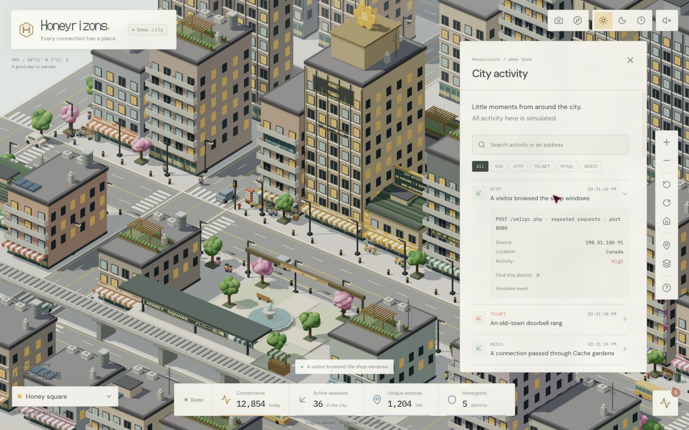
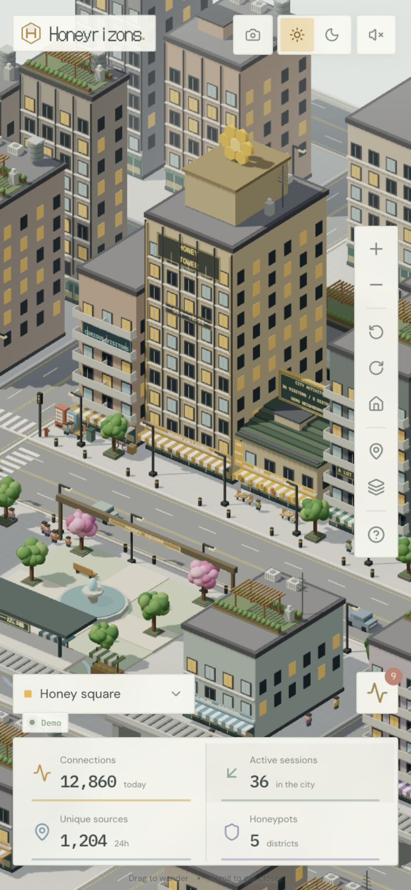

# Honeyrizons city frontend

An original Three.js implementation of the explorable voxel-city direction from [ZStreet](https://zstreet.cash/). Honeyrizons has five honeypot protocol districts, moving citizens and traffic, an elevated tram, storefronts, a garden square, and day/night lighting.

## Run the frontend

From the repository root:

```sh
bun install
bun run dev:web
```

Open `http://localhost:5173`. This command starts only Vite. The city uses local simulated events and does not request `/api`, open an SSE connection, or start the honeypot.

```sh
bun run build:web
bun run typecheck
```

The original dashboard is preserved at `/dashboard`. That route still uses the existing API when it is running.

## Explore

Drag to pan, scroll or pinch to zoom, and right-drag or use two fingers to rotate. The toolbar provides the same actions for keyboard navigation. Choose a district, click a protocol landmark, or open the activity panel to inspect a demo visit and navigate to its district.

The top-right controls change day/night, follow the local clock, start a camera tour, enable quiet city ambience, or open photo mode. Photos export as PNGs with the chosen Original, Noir, or Golden filter. Sound starts only after a click.

`H` returns to the square, `N` changes day/night, `+` and `-` zoom, `Space` pauses the simulation when the page has focus, and `Escape` closes panels or photo mode. The city respects reduced motion, including a static demo feed and disabled automatic tours. Mobile layouts support portrait and landscape.

## Code and future integration

All city code lives in `apps/web/src/city/`:

- `CityApp.tsx`: interface, panels, selection, filters and camera actions.
- `CityCanvas.tsx`: asynchronous scene loading and React lifecycle cleanup.
- `CityScene.ts`: orthographic camera, input, render loop, lighting, photo export and disposal.
- `world.ts` and `geometry.ts`: locally authored city geometry, textures, moving props and material batches.
- `model.ts` and `useDemoCity.ts`: district definitions and the local demo source.

To connect the honeypot later, replace the event producer in `useDemoCity.ts` with an adapter that maps real events to `CityEvent`. Keep the scene independent of the transport. The headline statistics currently contain illustrative demo values; they also need real aggregation when live data is connected.

Fonts are bundled locally. The city does not download models, textures, audio, or fonts at runtime. Three.js loads separately from the interface. Static geometry uses instancing, moving props share or merge geometry, pixel ratio is capped at 1.5, and paused frames skip unnecessary rendering. Hidden tabs stop the render loop.

## Captures

Reference screenshots and a compressed reference recording are in [`reference/`](reference/). Implementation screenshots and the walkthrough are in [`preview/`](preview/). The design notes are in [`design.md`](design.md); browser checks are in [`verification.md`](verification.md).





