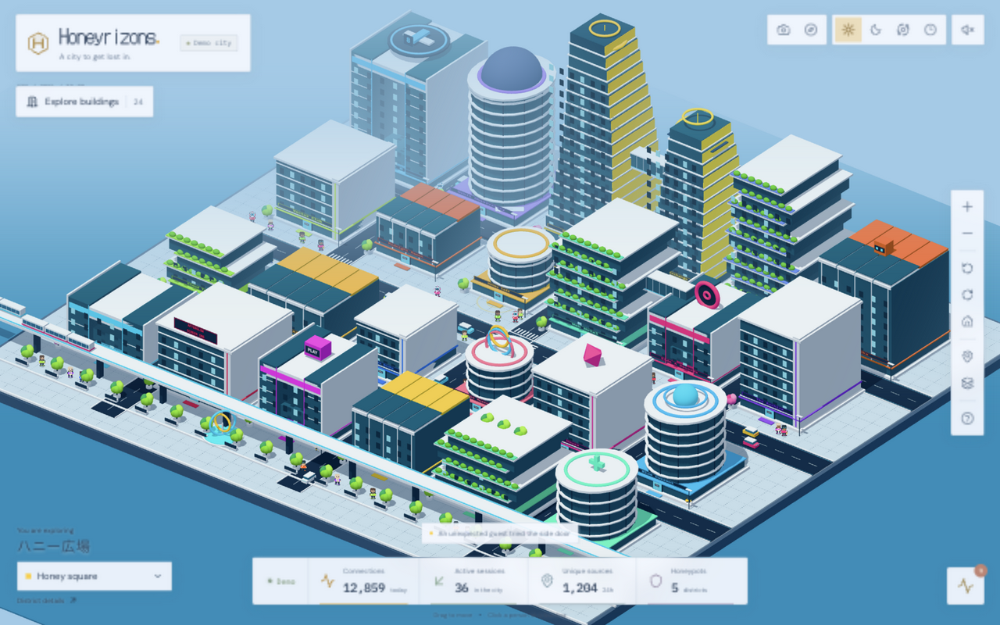
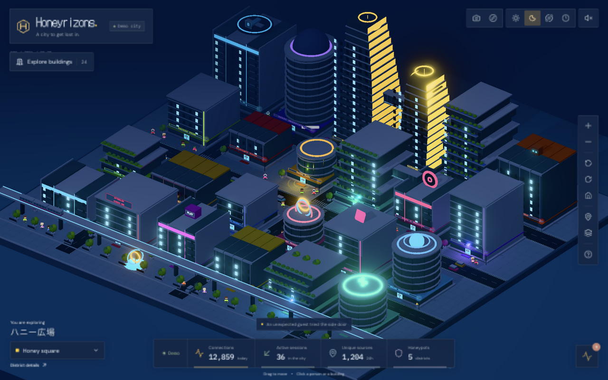
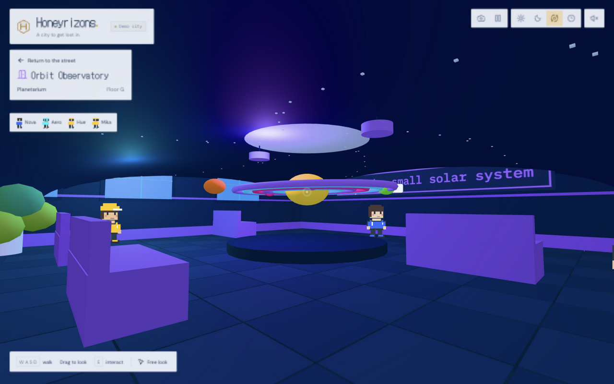
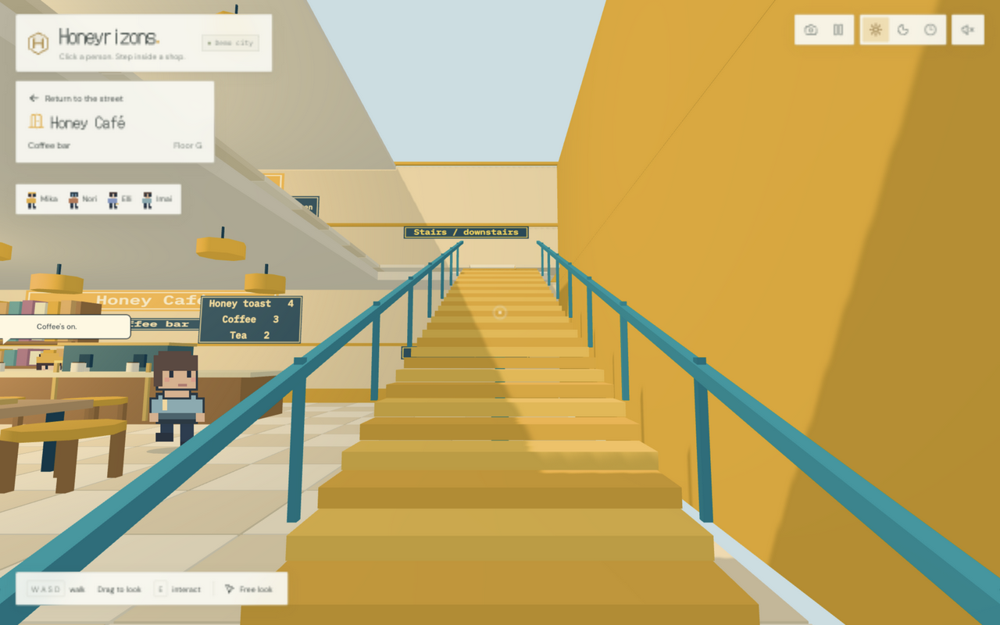
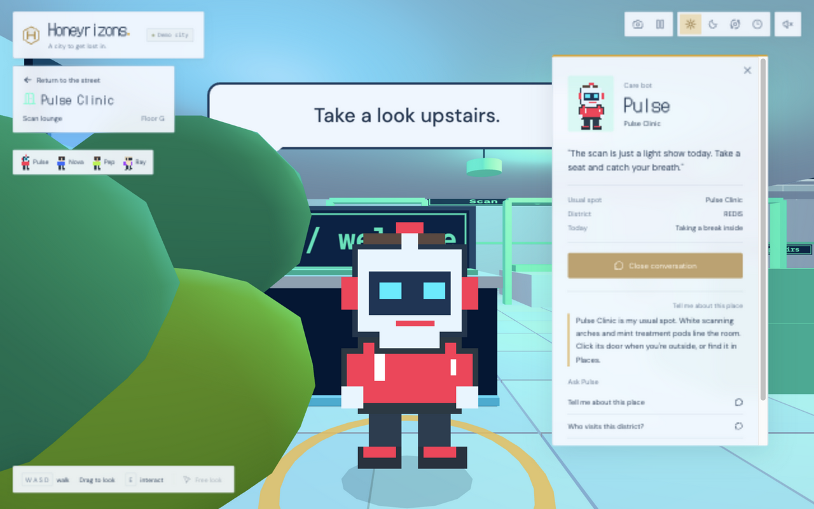
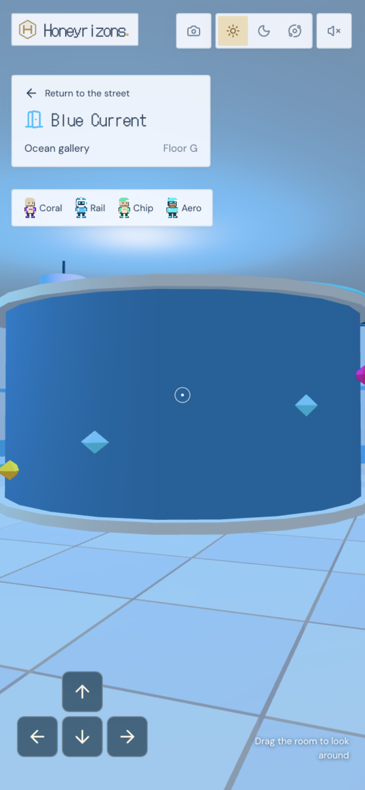

# Honeyrizons city frontend

An explorable Three.js city inspired by [ZStreet](https://zstreet.cash/). The revised city has 24 public buildings, 46 original floor plans, glass towers, planted terraces, skybridges, electric shuttles and a waterfront maglev. Every building opens a first-person interior with moving pixel residents. A six-minute city day changes the sunlight, sky, windows and street lamps.

## Run

The city is the **City** page of the dashboard (`/city`). From the repository root:

    bun install
    bun run dev

Open http://localhost:5173/city. It shows the live honeypot: run `bun run attack` or `bun run seed` to see districts light up.

    bun run build
    bun run typecheck
    bun test tests/room-walking.test.ts

## Explore

Outside, drag to pan, scroll or pinch to zoom, and right-drag or use two fingers to rotate. Click a building to enter, or pick one from the Buildings button in the toolbar. Click a resident to talk or follow.

Inside, use WASD or ZQSD to walk, Shift to walk faster, and drag to look. Arrow keys walk and turn. E or Enter interacts with the object under the crosshair. Free look locks the mouse; Escape releases it. Phones have four movement buttons and drag-to-look controls.

Stairs connect the floors without scene cuts. The floor menu offers shortcuts. Walking through the ground-floor door, Return to the street, or Escape restores the outdoor camera. Resident shortcuts find a clear spot nearby and face the character. Talking pauses player input. Coffee, watering and record actions run locally.

The city is always at night, to match the dashboard. Pause (Space), reduced motion and hidden tabs stop traffic, residents and attackers while allowing manual walking. Sound starts after a click. Photo mode exports PNGs.

## Buildings and floors

| Building | Ground floor | Upstairs |
| --- | --- | --- |
| Honey Tower | Arrival hall | City command, sky deck |
| Honey Café | Circular espresso lab | Drawing atelier |
| Web Hotel | Check-in lounge | Infinity pool lounge |
| Side A Records | Vinyl exchange | DJ sound stage |
| The Archive | Memory hall | Server vaults |
| Cloud Tea | Tea pavilion | Reflecting rain garden |
| Cache Gardens | Hydroponic lab | Citrus terrace |
| Midnight Ramen | U-shaped noodle counter | |
| Corner Books | Book maze | |
| Pixel Palace | Racing and rhythm arcade | Tournament arena |
| Bot Works | Robot assembly conveyor | Bot nursery and test track |
| Blue Current | Cylindrical aquarium | Marine lab |
| Maglev Central | Ticket concourse | Dispatch gallery |
| Afterglow Cinema | Screening room | Projection booth |
| Prism House | Fashion runway | Wardrobe lab |
| Maker Station | Fabrication hall | Print room |
| Pulse Clinic | Scan pods | Recovery garden |
| Orbit Observatory | Domed planetarium | Telescope deck |
| Skyport 8 | Courier hangar | Flight lounge |
| Vector Club | Movement studio | Running circuit |
| Circuit Market | Four food stalls | Test kitchen |
| Chromatic Lofts | Open apartment | Residents' commons |
| Solar Exchange | Power core gallery | Battery library |
| Light Museum | Light tunnel and sculptures | |

## Code and integration

Frontend code lives in [apps/web/src/city](../../apps/web/src/city/) and renders inside the dashboard shell
(`components/block/analytics-dashboard.tsx`), which loads it lazily so three.js only ships when the page opens.

- `CityPage.tsx` composes the page: the 3D stage fills the dashboard's main area, with overlays that reuse the
  dashboard's primitives and tokens (`CityToolbar`, `CityServiceLabels`, `CityServiceCard`, `CityFeed`,
  `ExploreOverlay`); `city.css` is scoped under `.city-page`.
- **Building = service.** `SERVICE_BUILDINGS` in `model.ts` maps each honeypot service port to a landmark: SSH →
  Honey Tower, WordPress → Web Hotel, MCP → Bot Works, Telnet → Circuit Market, MySQL → The Archive, Redis → Cache
  Gardens. A label above each one shows its sessions in the last 24h and its worst severity; clicking it opens the
  service card.
- **Attacker = person.** `useCityActivity.ts` turns the last 24h of sessions into attackers (most severe and most
  recent first, up to 32). `attackers.ts` walks them along the streets to their service's door, lets them loiter,
  and sends them back out before they return. Humans wear hoods, AI agents (MCP) are bots, and medium-and-above
  threats carry a severity marker drawn over the buildings at a constant size. New sessions walk in immediately and
  ring the door in their severity color. Clicking an attacker (or its marker) opens its session in the dashboard's
  details panel, and the open session is circled in the street.
- The city is always at night, lit and graded to the dashboard's charcoal background so the canvas edge disappears.
- `CityCanvas.tsx` / `CityScene.ts` own the three.js scene behind the imperative `CityHandle` API. The scene adapts to
  its container and reports hover positions relative to the canvas.
- `explore.ts` is the shared building catalog for exterior geometry, entrances, floor menus and residents.
  `roomLayouts.ts` authors each floor plan, `interiors.ts` assembles connected floors, `RoomController.ts` handles
  walking, collision and stairs, and `world.ts` constructs the skyline and traffic. Sprites and portraits share
  original canvas pixel art.

Residents and their conversations stay local, scripted flavor; everything about attacks comes from the honeypot.

## Captures

The [walkthrough](preview/pov-walkthrough.mp4) visits the planetarium, climbs Honey Tower's stairs, meets the clinic bot and returns to the city at night. Screenshots below show the revised city. Older outdoor clips in this directory document earlier design passes.

[Design notes](design.md), [verification](verification.md) and [reference captures](reference/) provide context.
